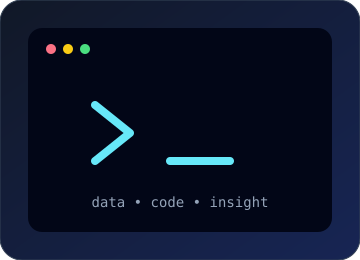

  

  
   
  

 

<table align="center">
  <tr>
    <td width="56%" valign="top">
      <h2>「 About Me 」</h2>
      
I'm <strong>Sustri</strong>, an Informatics student interested in the intersection of technology, data, and intelligent systems.

      
I enjoy transforming raw data into useful insights and building practical projects while continuously improving my technical skills.

      <ul>
        <li>Currently working on my final project</li>
        <li>Exploring machine learning and deep learning</li>
        <li>Interested in data analysis and visualization</li>
        <li>Open to collaboration and knowledge sharing</li>
      </ul>
    </td>
    <td width="44%" align="center" valign="middle">
      
    </td>
  </tr>
</table>

## ✦ Areas of Interest

  <table>
    <tr>
      <td align="center" width="33%"><strong>⟡ Artificial Intelligence</strong> Intelligent systems and automation</td>
      <td align="center" width="33%"><strong>◇ Machine Learning</strong> Models that learn from data</td>
      <td align="center" width="33%"><strong>⋆ Data Analysis</strong> Patterns, insights, and stories</td>
    </tr>
  </table>

## ⌘ Tech Stack

  
<strong>Languages</strong>

  
  
<strong>Data Science &amp; Machine Learning</strong>

  
  
  
  
  
<strong>Tools</strong>

  

## ⌁ GitHub Analytics

  
  

 

  

 

  

## ⟡ Goals &amp; Direction

| Learn | Build | Connect |
|:---:|:---:|:---:|
| Deep learning | Real-world data projects | With fellow learners |
| Advanced analytics | AI-powered solutions | Through open source |
| Better engineering | Portfolio projects | By sharing knowledge |

## 「 Let's Connect 」

  
  
  

 

  <i>“Data is valuable when it is refined into insight.”</i>
    
  

